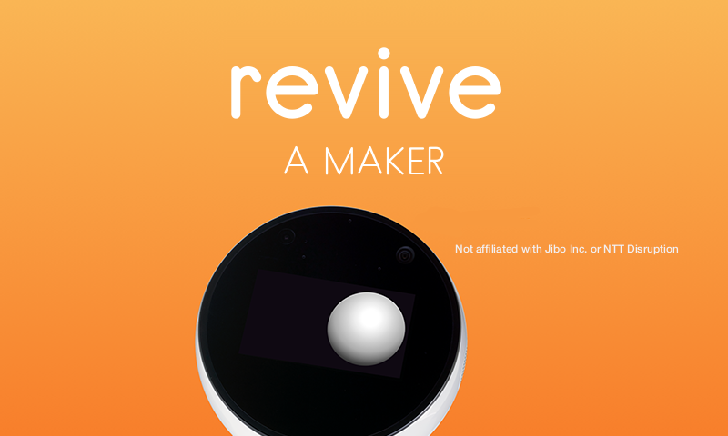

# Revive-A-Maker


Revive-A-Maker brings back Be a Maker, Jibo's Scratch companion: snap blocks together to make Jibo talk, listen, look around, show pictures and react to touch. Jibo Inc.'s cloud shut down in 2019 and broke the stock app; Revive-A-Maker talks to Jibo directly over your Wi-Fi, with no account or cloud.

This is a Jibo Revival Group preservation project. It is not affiliated with Jibo Inc. or NTT Disruption.

## Get it

Your phone, tablet or computer must be on the same Wi-Fi as Jibo. Tablets are recommended.

- **iPhone and iPad:** add the 5x1 source (`https://apps.5x1.com/source.json`) to AltStore or SideStore and install Revive-A-Maker, or download the `.ipa` from the [latest release](https://github.com/Jibo-Revival-Group/Revive-A-Maker/releases/latest).
- **Android:** install it from the 5x1 F-Droid repo (`https://apps.5x1.com/fdroid/repo`), or the `.apk` in the [latest release](https://github.com/Jibo-Revival-Group/Revive-A-Maker/releases/latest). The app tells you when a new version is out.
- **Computer:** run the web app (below) and open it in a browser.

Then add your Jibo by IP address (Jibo shows it in Settings › Wi-Fi) and connect. Revive-A-Maker uses Jibo's remote-operation service (ROM): port 7160 on a stock robot, 8160 on 5x1 robots.

## Web app

```bash
cd web
npm install
npm start
```

Open `http://127.0.0.1:5173`. Scratch projects are kept in the browser. `npm test` runs the tests.

## Repo layout

| Path | What it is |
| --- | --- |
| `web/` | The app itself: a small Node server (pairing by IP, ROM through [`rom-control`](https://www.npmjs.com/package/rom-control)) and its pages |
| `NewAndroidAppSource/` | Android app: runs `web/` with [nodejs-mobile](https://github.com/nodejs-mobile/nodejs-mobile) in a WebView. Gradle copies `web/`, `assets/` and `res/` in at build time |
| `Vicios/` | iPhone and iPad app (by imvic): talks ROM in Swift and shows its own copy of the pages (`AppResources/BeMakerWeb.bundle`) |
| `assets/`, `res/` | The stock app's Scratch playground, images, animations and sounds, served by the web app |
| `smali/`, `original/`, `AndroidManifest.xml`, `apktool.yml`, `unknown/` | The original stock APK with the login patch, as an apktool project. Legacy: see [docs/patch-notes.md](docs/patch-notes.md) |

## Building

- **Android:** open `NewAndroidAppSource/BeAMaker` in Android Studio, or run `./gradlew assembleRelease` there. Needs Node.js and npm for the bundled server.
- **iPhone and iPad:** open `Vicios/Be a Maker IOS/Be a Maker/Be a Maker.xcodeproj` in Xcode 26.
- **CI:** every push builds both (`.github/workflows/build.yml`). A `v*` tag publishes them as a release. Bump the version first: versionName and versionCode in `NewAndroidAppSource/BeAMaker/app/build.gradle`, and MARKETING_VERSION in the Xcode project.

## Credit / Disclaimer

The original smali patching and analysis were done with help from Claude (Anthropic), Gemini (Google), GitHub Copilot (Microsoft) and ChatGPT (OpenAI); the maintainer did the decompiling, device testing and patching. The iOS app is by imvic.

This project exists to preserve hardware that owners already have, made necessary by the shutdown of Jibo Inc.'s servers.

See [`license`](license) for the BSD 3-Clause terms.
